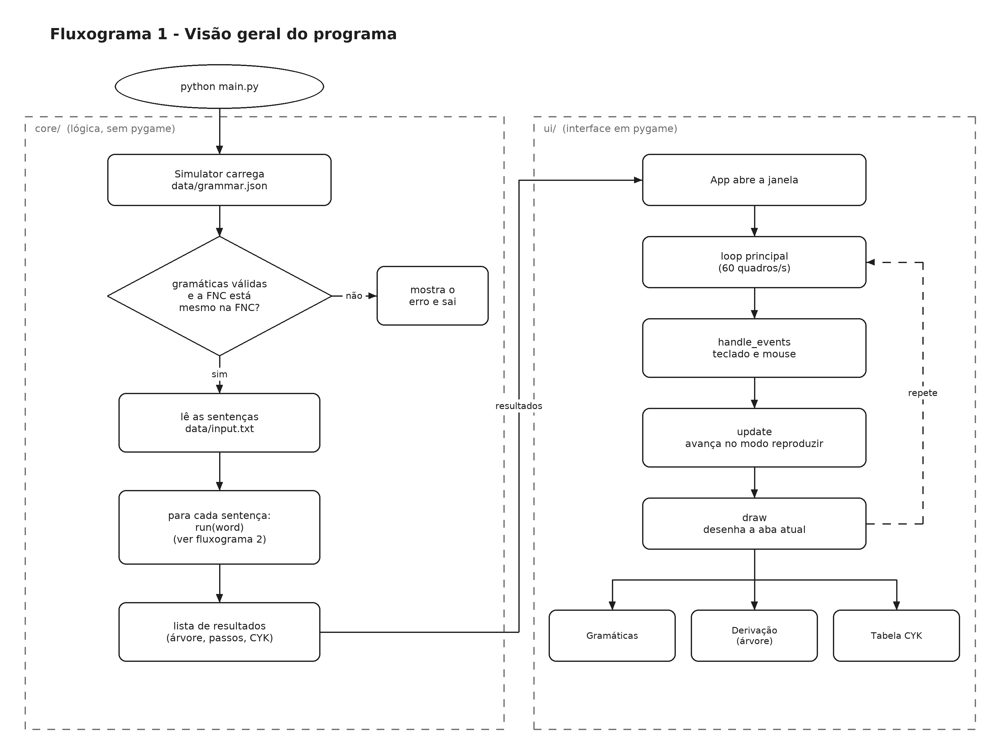
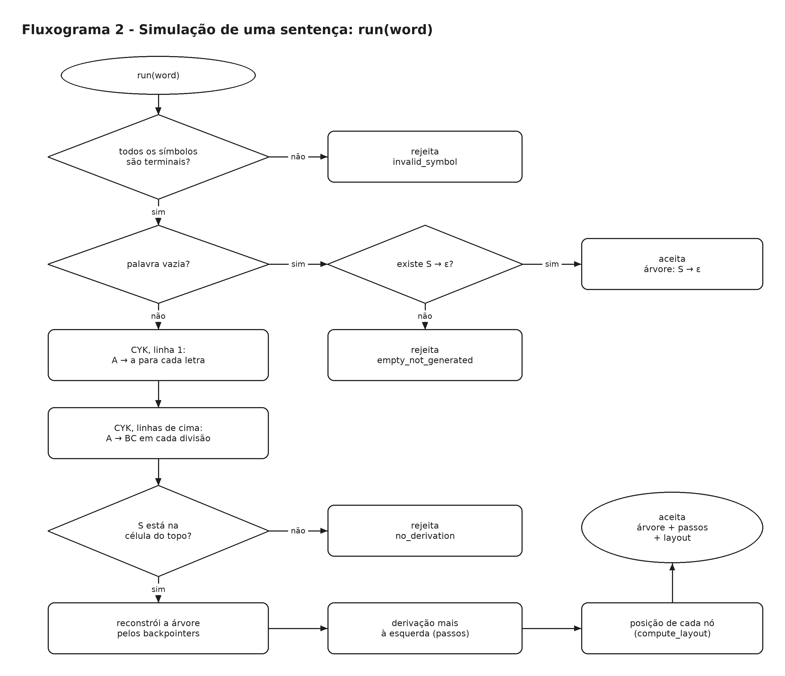

# cfg-derivation-simulator

Simulador de derivação de uma Gramática Livre de Contexto (GLC) na Forma Normal de Chomsky (FNC), feito em Python com interface em pygame. As gramáticas ficam em um arquivo JSON e as sentenças em um arquivo de texto, então é possível trocar de gramática sem alterar o código.

O projeto foi feito como trabalho acadêmico: construir a GLC do Exercício 5, simplificá-la, deixá-la na FNC e simular o processo de derivação mostrando a árvore.

## Status

* Núcleo (leitura e validação das gramáticas, CYK, árvore e derivação mais à esquerda): pronto.
* Interface em pygame com as gramáticas, a árvore animada passo a passo e a tabela CYK: pronta.
* Testes automáticos com `unittest`: prontos.

## Estrutura

```
cfg-derivation-simulator/
├── main.py
├── core/
│   ├── simulator.py
│   ├── grammar.py
│   ├── cyk.py
│   ├── derivation.py
│   ├── tree_layout.py
│   └── input_reader.py
├── ui/
│   ├── app.py
│   ├── views.py
│   ├── widgets.py
│   └── theme.py
├── tests/
│   └── test_cyk.py
├── data/
│   ├── grammar.json
│   ├── grammar.example.json
│   └── input.txt
├── docs/
│   ├── 1-visao-geral.png
│   └── 2-simulacao-sentenca.png
└── requirements.txt
```

A pasta `core/` tem toda a lógica e não importa pygame. A pasta `ui/` só desenha o que recebe do `Simulator`.

| Arquivo | Descrição |
|---|---|
| `main.py` | Ponto de entrada. Lê os argumentos, cria o `Simulator` e abre a janela |
| `core/simulator.py` | Classe `Simulator`: junta o back e é a única coisa que a interface usa |
| `core/grammar.py` | Classe `Grammar`: carrega, valida, verifica a FNC e formata as regras |
| `core/cyk.py` | Algoritmo CYK e reconstrução da árvore de derivação |
| `core/derivation.py` | Nó da árvore e derivação mais à esquerda, passo a passo |
| `core/tree_layout.py` | Calcula a posição de cada nó da árvore (sem pygame) |
| `core/input_reader.py` | Lê o arquivo de sentenças |
| `ui/app.py` | Classe `App`: janela, loop do pygame, eventos e estado da tela |
| `ui/views.py` | Desenho de cada tela: gramáticas, árvore, passos e tabela CYK |
| `ui/widgets.py` | Botões e lista de sentenças |
| `ui/theme.py` | Cores, fontes e tamanhos da interface |
| `tests/test_cyk.py` | Testes do CYK e da linguagem gerada |
| `data/grammar.json` | Gramática original e na FNC do Exercício 5 |
| `data/grammar.example.json` | Exemplo (aⁿbⁿ), para criar a sua própria gramática |
| `data/input.txt` | Sentenças de aceite e rejeite do enunciado |
| `docs/` | Fluxogramas do funcionamento do programa |

## Requisitos

* Python 3 (testado no 3.14).
* pygame-ce, única dependência, listada em `requirements.txt`. É o fork mantido do pygame, com a mesma API (`import pygame`) e com versão pronta para o Python 3.14.

## Como executar

```
python -m venv .venv
source .venv/bin/activate        # no Windows: .venv\Scripts\activate
pip install -r requirements.txt
python main.py
```

Para usar outra gramática ou outro arquivo de sentenças, passe os caminhos como argumento:

```
python main.py data/grammar.example.json data/input.txt
```

Para rodar os testes:

```
python -m unittest discover -s tests
```

## Como usar

A janela tem a lista de sentenças à esquerda e três abas no topo.

| Aba | O que mostra |
|---|---|
| Gramáticas | A gramática original e a gramática na FNC, lado a lado |
| Derivação | A árvore de derivação crescendo passo a passo e a derivação mais à esquerda |
| Tabela CYK | A tabela do algoritmo CYK, que mostra por que a sentença foi aceita ou rejeitada |

Cada sentença da lista mostra o resultado esperado (do arquivo) e o obtido pelo programa. O resumo embaixo da lista diz quantas bateram com o esperado.

| Tecla | Ação |
|---|---|
| `←` / `→` | Passo anterior / próximo |
| `Espaço` | Reproduz ou pausa a derivação |
| `Home` / `End` ou `R` | Vai para o primeiro / último passo (`R` reinicia) |
| `↑` / `↓` | Sentença anterior / próxima |
| `Tab` ou `1`, `2`, `3` | Troca de aba |
| `F5` | Relê o arquivo de sentenças |
| `Esc` | Fecha o programa |

## Fluxo de execução

O fluxograma 1 mostra o caminho geral do programa, e o fluxograma 2 mostra o que acontece com cada sentença.






* `main.py` cria o `Simulator`, que carrega as duas gramáticas do JSON, valida e confere se a seção `cnf` está mesmo na FNC. Se algo estiver errado, o programa mostra o erro e não abre a janela.
* O `Simulator` lê `data/input.txt` e roda o CYK de cada sentença usando a gramática na FNC.
* Quando a sentença é aceita, a árvore é reconstruída pela tabela do CYK, e a partir dela são gerados os passos da derivação mais à esquerda e a posição de cada nó.
* `App` recebe esses resultados prontos e só desenha. A interface não deriva nada nem lê os arquivos diretamente.

## Gramática incluída

O arquivo `data/grammar.json` tem a gramática do Exercício 5, a mesma do relatório.

L₅ = { aⁱbʲcᵏ | i = j + k } ∪ { aⁱbʲcᵏ | k = i + j }

Gramática original:

```
S → A | B
A → aAc | C
C → aCb | ε
B → aBc | D
D → bDc | ε
```

Gramática na FNC:

```
S → XE | XZ | XF | XY | XG | YH | YZ | ε
A → XE | XZ | XF | XY
C → XF | XY
B → XG | XZ | YH | YZ
D → YH | YZ
E → AZ
F → CY
G → BZ
H → DZ
X → a
Y → b
Z → c
```

* Aceitar: ε, ab, ac, bc, aabc, abcc
* Rejeitar: abc, aabbcc, a, cc, ba

## Como criar a sua própria gramática

Copie `data/grammar.example.json` e altere os valores. O arquivo tem estes campos:

| Campo | Descrição |
|---|---|
| `name` | Nome da gramática. Texto livre |
| `language` | Descrição da linguagem, mostrada na tela. Texto livre |
| `terminals` | Lista dos terminais. Cada um tem um único caractere |
| `start` | Símbolo inicial |
| `original` | Gramática original: `variables` (ordem de exibição) e `productions` |
| `cnf` | Gramática na FNC, no mesmo formato. É ela que é usada na simulação |

Em `productions`, cada variável tem a lista dos seus lados direitos, escritos como texto (`"aAc"`), e `ε` representa a produção vazia. Por isso todos os símbolos precisam ter um único caractere.

Regras verificadas ao carregar:

* Todo símbolo tem um único caractere, e nenhum é variável e terminal ao mesmo tempo.
* O símbolo inicial está nas variáveis.
* Toda produção usa só variáveis e terminais declarados.
* A seção `cnf` só tem produções `A → BC`, `A → a` e `S → ε`, esta última apenas se `S` não aparece do lado direito de nenhuma produção.

Quando uma sentença tem mais de uma árvore, a ordem das produções no JSON decide qual delas aparece.

## Arquivo de sentenças

Uma sentença por linha, separadas pelas seções `[aceitar]` e `[rejeitar]`. Linhas vazias e linhas começando com `#` são ignoradas, e `ε` representa a sentença vazia.

```
[aceitar]
ε
ab

[rejeitar]
abc
```

## Resultado de `run`

`Simulator.run(word, expected)` devolve um dicionário:

| Campo | Descrição |
|---|---|
| `word` | Sentença testada |
| `accepted` | `True` se a sentença foi aceita |
| `expected` | Resultado esperado no arquivo (`True`, `False` ou `None`) |
| `matches` | `True` se o obtido bate com o esperado |
| `reason` | Motivo da rejeição, ou `None` se aceita |
| `error_position` | Posição do símbolo inválido, ou `None` |
| `tree` | Raiz da árvore de derivação (`Node`), ou `None` |
| `table` | Tabela CYK: `table[tamanho - 1][início]` com as variáveis de cada trecho |
| `steps` | Passos da derivação mais à esquerda (`form`, `rule`, `expanded`, `visible`) |
| `layout` | Posição de cada nó, largura e profundidade da árvore |

Valores possíveis de `reason`:

| Valor | Significado |
|---|---|
| `no_derivation` | O símbolo inicial não está na célula do topo da tabela CYK |
| `invalid_symbol` | A sentença tem um símbolo que não é terminal da gramática |
| `empty_not_generated` | A sentença é vazia e a gramática não tem `S → ε` |
